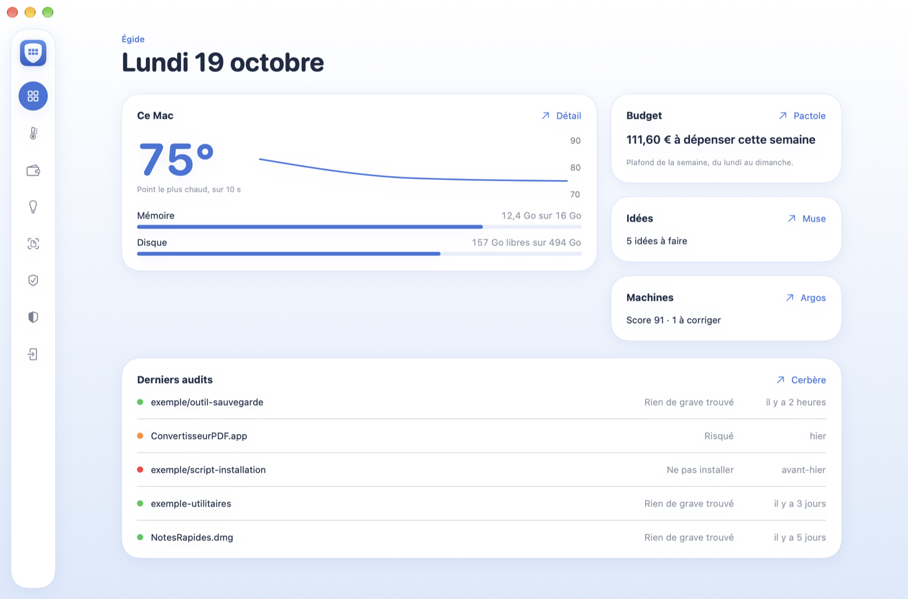
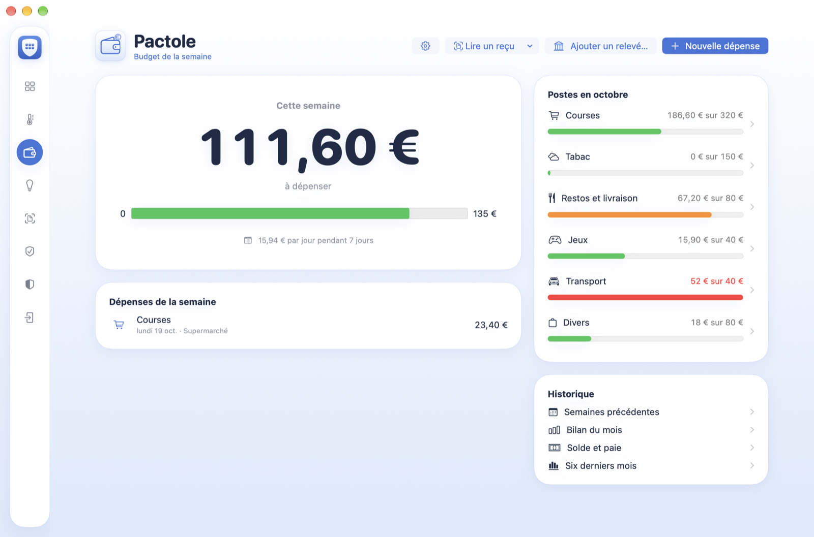
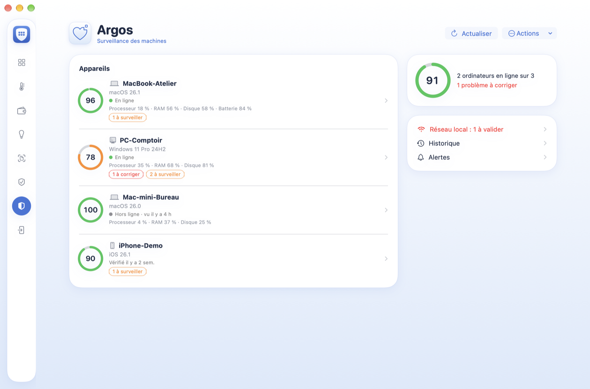

# Égide

Mes outils du quotidien, réunis dans une seule app, sur le Mac et sur l'iPhone.
My everyday tools, gathered in a single app, on the Mac and on the iPhone.



Au départ il y avait sept petites apps écrites pour moi : un budget, un carnet d'idées, une surveillance de mes ordinateurs, la température du Mac… Avec un compte Apple gratuit, on ne peut signer que trois apps sur l'iPhone, et il faut les réinstaller tous les sept jours. J'ai donc tout rangé dans une seule app, un outil par onglet. Sur le Mac, les outils sont restés longtemps des apps séparées ; depuis octobre 2026 ils sont eux aussi dans une seule fenêtre, avec une seule icône dans la barre des menus.

Les captures de cette page sont faites en mode démo : les montants, les machines, les idées et les audits sont inventés.

## Ce dépôt

C'est la copie publique d'Égide, ouverte en octobre 2026. Le développement continue dans un dépôt privé ; je publie ici le code à chaque étape qui tient debout, en un seul commit, sans l'historique de travail.

Les tickets (issues) sont ouverts pour signaler un bug ou poser une question. Je ne prends pas de pull requests pour l'instant, puisque ce dépôt est regénéré à chaque publication.

## Les outils

| | |
|---|---|
| Pactole | Le budget de la semaine : ce qu'il reste à dépenser jusqu'à dimanche, les plafonds par poste, la lecture des reçus et du relevé de banque. |
| Muse | Idées, rappels et projets, synchronisés entre l'iPhone et le Mac par un dossier iCloud Drive. |
| Héphaïstos | Températures, ventilateur, mémoire et disque du Mac, avec alertes. La température s'affiche dans le menu d'Égide. |
| Cerbère | Audit d'un dépôt, d'une app ou d'un fichier avant de l'installer, sans jamais l'exécuter. Détails dans [docs/cerbere.md](docs/cerbere.md). |
| Argos | L'état de sécurité de mes ordinateurs et téléphones, lu sur un petit serveur qui tourne sur le Mac. |
| Iris | Sur l'iPhone, scanner un ticket, une facture ou un document et l'envoyer par mail. Sur le Mac, retrouver ces scans rangés par genre. |
| Hermès | Piloter le Mac depuis l'iPhone, chiffré de bout en bout, sans serveur tiers. |





## Comment c'est construit

Chaque outil est un framework Swift à part (`Modules/PactoleKit`, `Modules/MuseKit`…) avec ses propres tests. L'app iPhone (`Egide/`) et l'app Mac (`EgideMac/`) ne font qu'assembler ces modules et dessiner l'accueil. Un même module sert les deux plateformes quand c'est possible ; sinon ses sources sont rangées en `Shared/`, `iOS/` et `macOS/`.

Le thème vit dans `Modules/EgideUI` : quatre couleurs (bleu `#3F74D9`, encre `#1E2B45`, fond blanc vers bleu pâle, cartes blanches), une carte, un en-tête. Les écrans secondaires utilisent `egideTitre(_:)`, qui donne le titre de la barre de navigation sur l'iPhone et un en-tête dans la page sur le Mac.

Les données restent sur mes appareils. Pactole et Muse utilisent SwiftData, une base par outil ; la synchro passe par des fichiers dans iCloud Drive, sans compte ni service en ligne. Argos parle à un serveur installé sur le Mac, joignable depuis l'iPhone par Tailscale. Aucune bibliothèque extérieure.

Hermès est un cas à part. L'agent qui filme l'écran et rejoue la souris reste une app séparée : c'est elle seule qui a le droit d'enregistrer l'écran et qui garde la clé du Mac. L'onglet Hermès d'Égide sur le Mac se contente de lire son état et de l'ouvrir ; il ne peut ni appairer ni révoquer un iPhone.

Le code est en Swift 6, sauf Hermès, encore en Swift 5 le temps de réécrire son client vidéo.

```
Egide/          app iPhone
EgideMac/       app Mac : fenêtre, accueil, barre des menus
Modules/        un framework par outil, avec ses tests
CerbereMac/     vues Mac de Cerbère (aussi compilées en app seule)
HephaistosMac/  vues Mac d'Héphaïstos (idem)
PactoleMac/     app Mac de Pactole seule
CerbereCLI/     Cerbère en ligne de commande
installer/      scripts d'installation
docs/           notes de conception, captures
```

## Compiler

Il faut Xcode 26 et [XcodeGen](https://github.com/yonaskolb/XcodeGen). Avant de générer le projet, remplacez dans `project.yml` mon équipe de signature (`DEVELOPMENT_TEAM`) et le préfixe des identifiants (`bundleIdPrefix`) par les vôtres ; un compte Apple gratuit suffit.

```bash
xcodegen generate
xcodebuild -project Egide.xcodeproj -scheme EgideMac build
xcodebuild test -project Egide.xcodeproj -scheme Egide \
  -destination 'platform=iOS Simulator,name=iPhone 18 Pro'
```

Les scripts de `installer/` sont écrits pour mes machines : `install-mac.sh` récupère Égide depuis mon dépôt privé et ne fonctionnera pas ailleurs. Pour essayer l'app, compilez-la avec les commandes ci-dessus.

## Mode démo

Le mode démo remplit chaque outil de données inventées, sans lire ni écrire dans les vraies bases. On peut ainsi faire le tour de l'app sans serveur Argos, sans iPhone appairé et sans ses propres données. Les captures de cette page ont été faites de cette façon.

```bash
open EgideMac.app --args -egide.demo YES
```

Pour refaire les captures, ajouter `-egide.captures` suivi d'un dossier : l'app ouvre chaque onglet, enregistre la fenêtre en PNG dans ce dossier, puis se ferme.

```bash
open EgideMac.app --args -egide.demo YES -egide.captures ~/Desktop/captures
```

## Licence

MIT, voir [LICENSE](LICENSE).

---

It started as seven small apps I wrote for myself: a budget, an idea notebook, a monitor for my computers, the Mac's temperature… With a free Apple account you can only sign three apps on the iPhone, and you have to reinstall them every seven days. So I moved everything into one app, one tool per tab. On the Mac the tools stayed separate apps for a long time; since October 2026 they share a single window too, with a single icon in the menu bar.

The screenshots on this page were taken in demo mode: the amounts, machines, ideas and audits are made up.

## This repository

This is the public copy of Égide, opened in October 2026. Development goes on in a private repository; I publish the code here whenever a stage holds together, as a single commit, without the work history.

Issues are open for bug reports and questions. I don't take pull requests for now, since this repository is regenerated at each release.

## The tools

| | |
|---|---|
| Pactole | The week's budget: what is left to spend until Sunday, monthly limits per category, reading receipts and bank statements. |
| Muse | Ideas, reminders and projects, synced between iPhone and Mac through an iCloud Drive folder. |
| Héphaïstos | Mac temperatures, fan, memory and disk, with alerts. The temperature shows in Égide's menu. |
| Cerbère | Audits a repository, an app or a file before you install it, without ever running it. Details in [docs/cerbere.md](docs/cerbere.md) (French). |
| Argos | The security status of my computers and phones, read from a small server running on the Mac. |
| Iris | On the iPhone, scan a receipt, an invoice or a document and send it by email. On the Mac, find those scans sorted by kind. |
| Hermès | Control the Mac from the iPhone, end-to-end encrypted, with no third-party server. |

## How it is built

Each tool is its own Swift framework (`Modules/PactoleKit`, `Modules/MuseKit`…) with its own tests. The iPhone app (`Egide/`) and the Mac app (`EgideMac/`) only assemble these modules and draw the home screen. One module serves both platforms when possible; otherwise its sources are split into `Shared/`, `iOS/` and `macOS/`.

The theme lives in `Modules/EgideUI`: four colours (blue `#3F74D9`, ink `#1E2B45`, a white to pale blue background, white cards), one card, one header. Secondary screens use `egideTitre(_:)`, which sets the navigation bar title on the iPhone and an in-page header on the Mac.

Data stays on my devices. Pactole and Muse use SwiftData, one store per tool; syncing goes through files in iCloud Drive, with no account or online service. Argos talks to a server installed on the Mac, reachable from the iPhone over Tailscale. No third-party libraries.

Hermès is a special case. The agent that captures the screen and replays the mouse stays a separate app: it alone holds the screen recording permission and the Mac's key. The Hermès tab in Égide on the Mac only reads its status and opens it; it can neither pair nor revoke an iPhone.

The code is Swift 6, except Hermès, still on Swift 5 until its video client is rewritten.

## Building

You need Xcode 26 and [XcodeGen](https://github.com/yonaskolb/XcodeGen). Before generating the project, replace my signing team (`DEVELOPMENT_TEAM`) and the identifier prefix (`bundleIdPrefix`) in `project.yml` with your own; a free Apple account is enough.

```bash
xcodegen generate
xcodebuild -project Egide.xcodeproj -scheme EgideMac build
xcodebuild test -project Egide.xcodeproj -scheme Egide \
  -destination 'platform=iOS Simulator,name=iPhone 18 Pro'
```

The scripts in `installer/` are written for my own machines: `install-mac.sh` fetches Égide from my private repository and won't work elsewhere. To try the app, build it with the commands above.

## Demo mode

Demo mode fills every tool with made-up data and never reads or writes the real stores. You can look around the whole app without an Argos server, a paired iPhone or any data of your own. The screenshots on this page were taken that way.

```bash
open EgideMac.app --args -egide.demo YES
```

To redo the screenshots, add `-egide.captures` followed by a folder: the app opens each tab, saves the window as a PNG in that folder, then quits.

```bash
open EgideMac.app --args -egide.demo YES -egide.captures ~/Desktop/captures
```

## Licence

MIT, see [LICENSE](LICENSE).
